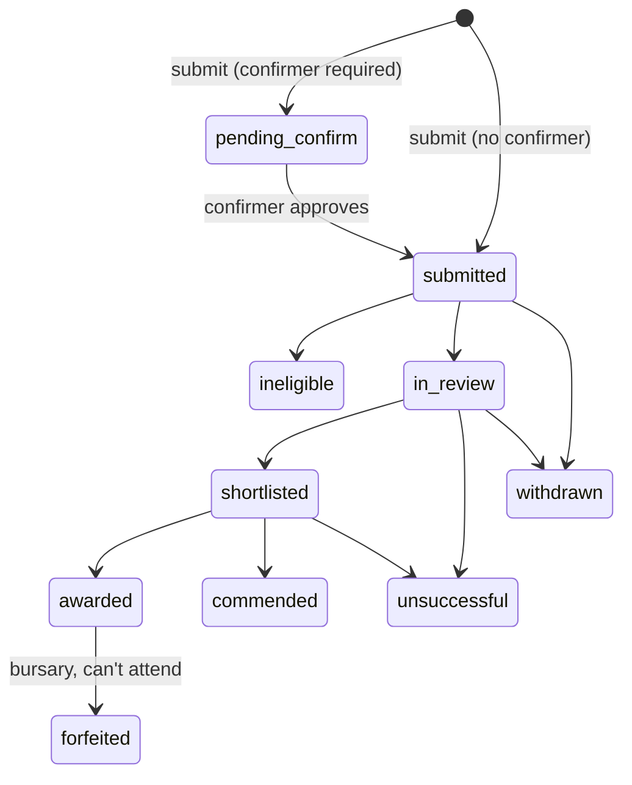

# qhta-competitions — spec & Claude Code handover

**Status:** spec v3 — §10 answered + feature-flag integration (§5.11), not built · **Owner:** Tim · **Drafted:** 6 Nov 2026
**Source forms:** *QHTA Historical Writing Competition 2026 Entry Form* (PDF); *QHTA Bursary Application — Early Career Conference 20 Feb 2027* (PDF)

---

## 1. Problem

QHTA runs submission-based programs as fillable/printed PDFs returned by email to qhta@qhta.com.au. That means: wet or scanned signatures, attachments scattered across a mailbox (which is already the Hostinger migration blocker), manual eligibility checks, judging tracked in someone's head or a spreadsheet, and no clean record of publication consent.

Two programs exist today, and they share one shape:

| | Writing Competition | ECC Bursary |
|---|---|---|
| Who submits | Teacher on behalf of student (teacher-only) | Teacher (applicant) |
| Categories | 15 (see §4.2) | 1 |
| Submission | Essay / ISI document, word count | ≤300-word written piece |
| Eligibility | Year level matches category | QCT-registered · QHTA member (individual or institutional) · lives & works outside SEQ |
| Third-party sign-off | Teacher/parent/guardian signature | Referee (Deputy/Principal) signature |
| Declarations | Original work; judges' decision final; publication consent | Accept T&Cs; selection committee final |
| Close | Admin-set datetime (2026 round = demo data) | Admin-set datetime (preset default 29 Jan 2027) |
| Review | Judging panel per category | Selection committee |
| Outcome | Winner / commended; possible journal/web publication | Up to $500 travel reimbursement + free ECC registration |
| Post-award | Publish, certificates | Free registration; travel reimbursement handled offline (out of scope) |

**Goal:** one plugin that models a generic "program round" (call for submissions → review → outcomes), configured per round, replacing both PDFs. Future programs (e.g. awards, grants) should be a new round, not new code.

**Dependency:** requires `wordpress-feature-flags` (wpff) 1.0.0 — built, repo https://github.com/timbrownls20/wordpress-feature-flag (API: `wpff_register` action, `wpff_register()`, `wpff_flag()`, `wpff_is_live()`, `wpff_mode()`, `wpff_preview_url()`). Visibility of every public surface goes through wpff (§5.11).

**Placement test:** survives the conference ending → yes. Separate plugin; not `qhta-conference-plugin`, not `qhta-commerce`. Integrations with commerce/membership are via hooks and `function_exists` guards, never hard dependencies.

---

## 2. Scope

### In (v1)
- Program rounds as a CPT, configurable in wp-admin (dates, categories, fields, declarations, eligibility rules, emails)
- Front-end submission form via shortcode, replacing both PDFs
- Typed-name + checkbox declarations with audit trail (replaces signatures)
- Referee / teacher confirmation via tokenised email link
- Protected file uploads
- Word count: live counter (inline text) and auto-count of uploaded .docx
- Eligibility checks (hard blocks vs. admin flags)
- Review: judge role, per-category assignment, anonymised view, rubric scoring, aggregate ranking
- Outcomes: status changes, templated notification emails, CSV export
- Bursary extras: optional ECC free-registration coupon (off by default — Q12 still open)
- Publication-consent register
- Data retention / purge

### Out (v1)
- Public voting, online payments, entry fees
- Certificate PDF generation (v1.1 — see §9)
- Student accounts / logins
- Mailchimp sync
- Bursary travel reimbursement / receipt handling (managed offline)
- Save-and-resume drafts
- QCT number validation

---

## 3. Data model

### 3.1 `qhta_program` (CPT, non-public, admin-only)
One post = one round, e.g. "Historical Writing Competition 2026", "ECC Bursary 2027".

| Meta | Type | Notes |
|---|---|---|
| `_qc_type` | enum `competition`\|`bursary`\|`generic` | Drives defaults only; behaviour comes from config |
| `_qc_opens_at`, `_qc_closes_at` | datetime (date **and** time), Australia/Brisbane | Admin picks both date and time per round (`<input type="datetime-local">`). Store UTC, display AEST. No hard-coded end-of-day |
| `_qc_late_grace_minutes` | int | Default 0 |
| `_qc_categories` | JSON array `{slug,label,year_levels[],word_min,word_max,submission_kind}` | `submission_kind`: `upload`\|`inline`\|`both` |
| `_qc_fields` | JSON schema (see §3.3) | Ordered field list |
| `_qc_declarations` | JSON array `{key,text,required}` | Stored verbatim on each submission at time of submit |
| `_qc_confirmer` | JSON `{role:'referee'\|none, label, email_field}` | §5.3 |
| `_qc_eligibility` | JSON rules | §5.5 |
| `_qc_rubric` | JSON `{criteria:[{key,label,max,weight}]}` | |
| `_qc_anonymise` | bool, default **true** | Judges don't see identifying fields |
| `_qc_entry_limits` | JSON `{per_entrant_per_category:int\|null, per_school_per_category:int\|null, per_entrant_total:int\|null}` | Set when creating each round; null = unlimited. Enforced as **block** at submit |
| `_qc_emails` | JSON templates keyed by event | Mustache-style `{{field}}` tokens (consistent with qhta-woo-invoice) |
| `_qc_award_config` | JSON | Bursary: `{coupon_enabled:false, coupon_product_id:4311, coupon_variation_id:null}` |
| `_qc_retention_months` | int | §7 |
| `_qc_word_count_rules` | JSON `{include_footnotes:true, exclude_after_headings:["Bibliography","References","Reference list","Works cited"]}` | §5.6 |

### 3.2 `qhta_submission` (CPT, non-public, `exclude_from_search`, no REST)
`post_parent` = program ID. Title auto: `{program} — {ref}`. Reference code `QC-2026-0042` (per-program sequence) — this is what judges and emails use.

Custom post statuses (registered, admin-only):

`qc_pending_confirm` → `qc_submitted` → `qc_in_review` → `qc_shortlisted` → `qc_awarded` | `qc_commended` | `qc_unsuccessful`
plus `qc_ineligible`, `qc_withdrawn`. Bursary adds `qc_forfeited` (awardee unable to attend).

Every transition writes to `_qc_log` (JSON array `{ts,user_id,from,to,note}`).

Meta: one `_qc_f_{key}` per form field; `_qc_category`; `_qc_word_count_declared`; `_qc_word_count_auto`; `_qc_declarations_accepted` (snapshot incl. text, typed name, ts, IP); `_qc_confirmation` (`{email,name,token_hash,sent_at,confirmed_at,ip}`); `_qc_files` (array of protected-file refs); `_qc_flags` (eligibility/word-count warnings); `_qc_publication_consent` (bool + ts — always true for writing comp, since consent is a required declaration).

### 3.3 Scores
Custom table `{prefix}qc_scores` — `id, submission_id, judge_user_id, criterion_key, score, comment, updated_at`, unique `(submission_id, judge_user_id, criterion_key)`. Created via `dbDelta` on activation with a schema-version option. (Post meta is a poor fit for per-judge × per-criterion data and aggregate queries.)

### 3.4 Field schema
Supported field types: `text`, `email`, `tel`, `textarea`, `richtext_limited` (inline written piece, word-counted), `select`, `radio`, `checkbox`, `year_level`, `address`, `file` (.docx/.pdf only), `heading`, `help`.
Each: `{key, type, label, required, help, options[], show_if:{field,equals}, judge_visible:bool, pii:bool}`.

`pii:true` fields are hidden in anonymised judge view and purged by retention (§7). Ship both programs' schemas as **presets** (JSON in `/presets/`) loadable when creating a round. The ECC Bursary preset is the real first round; the Writing Competition 2026 preset is **demo data** for showing the committee.

---

## 4. Program presets (from the attached forms)

### 4.1 ECC Bursary 2027
Fields: title+name, home address, email, phone, years teaching, school name, school address, **QCT registration number** (plain text, required, no format validation), **QHTA membership** (radio: individual / institutional + institution name), written piece (`richtext_limited`, max 300 words, prompt: *"Being an early career History teacher in Regional, Rural and Remote Australia"*, with the five guidance dot-points shown as help text), referee name, referee position, referee email, "not yet in post for 2027" toggle (relabels referee as "other professional referee"), **"I live and work outside South-East Queensland"** (required self-declaration checkbox).
Declarations: accept T&Cs (full text shown); attend the day; provide receipts; return bursary if unable to attend; selection committee decision final.
Confirmer: `referee`. Close datetime set by admin when creating the round; preset pre-fills 29 Jan 2027 00:00 AEST (i.e. "before 29th") as an editable default.

### 4.2 Historical Writing Competition 2026 (demo)
Used to demo the plugin; dates and judges are placeholders.
Categories (15): Year 7 · Year 8 · Year 9 · Year 10 · Y11 Ancient – Essay · Y11 Ancient – ISI · Y11 Modern – Essay · Y11 Modern – ISI · Y12 Ancient – Essay · Y12 Ancient – ISI · Y12 Modern – Essay · Y12 Modern – ISI · Australian First Nations Peoples History · Human Rights & Civil Liberties Yrs 7–10 · Human Rights & Civil Liberties Yrs 11–12.
Each category carries `year_levels[]` so the form only offers categories valid for the selected year level.
Each category also carries `word_min`/`word_max` (set per round; demo values placeholders).
Fields (teacher completes): student name, year level, school, teacher name, teacher email, teacher phone, principal name, school address, entry file (.docx/.pdf), declared word count (footnotes in, bibliography out — stated in help text). **No student email collected.**
Declarations (all required, made by the teacher): original work, no more than usual guidance; judges' decision final, no correspondence; **publication consent** (journal and/or website) — its own required checkbox, recorded separately so the consent register can report it.
Add a required teacher declaration: "I have the student's and parent/guardian's permission to submit this entry on these terms." This replaces the teacher/parent/guardian signature.
Confirmer: none — teacher-only submission.

---

## 5. Behaviour

### 5.1 Submission form
- Shortcode `[qhta_program_form program="ecc-bursary-2027"]` (slug or ID). Assets enqueued **only** when the shortcode renders (`has_shortcode` check on the queried post + render-time flag) — per the page-scoping rule.
- Server-rendered PHP form, progressive enhancement in **plain ES5** (conditional fields, live word counter, category filtering by year level). No build step.
- Before open: "opens {date}" message. After close (+grace): closed message. No plugin-specific preview param — preview is wpff's (§5.11).
- Form pages send `nocache_headers()` + `DONOTCACHEPAGE` + `X-LiteSpeed-Cache-Control: no-cache` (nonces and the time-on-page check break under page cache).
- Anonymous submission allowed (teachers aren't necessarily logged in). If logged in, prefill from user/PMPro billing fields.
- Nonce + honeypot field + minimum-time-on-page check. No CAPTCHA plugin.
- On submit: validate → create submission → store files → snapshot declarations → send confirmation to submitter (with reference code) and admin notification → if confirmer required, status `qc_pending_confirm` and send confirmer email.
- No drafts/save-and-resume (decided). Bursary piece is short; writing comp is a file upload.
- Entry limits (§3.1 `_qc_entry_limits`) checked at submit: count existing non-withdrawn submissions matching normalised student name + school (or school only) in the same category; block with a clear message.

### 5.2 Declarations (replacing signatures)
Each declaration is a required checkbox with its full text shown. Plus "Type your full name as your signature". Stored snapshot: declaration texts as shown, typed name, timestamp, IP, user agent. Admin view renders it as a signature block. Approved for both forms, including the referee (decided).

### 5.3 Confirmer flow (bursary referee)
- Email to confirmer with a single-use link `/?qc_confirm={token}` (token: 32 bytes random, stored hashed, expires closes_at + 7 days).
- Confirm page shows a summary of what they're vouching for (no file download for referees), declaration checkbox, typed name, optional comment (referee statement). Confirm → `qc_submitted`, log entry, notify submitter.
- Admin can resend link or manually mark confirmed (logged with note).
- Confirmer email must differ from submitter email (soft warning, admin flag).

### 5.4 Files
- Allowed: `.docx` and `.pdf` only — no `.doc`, no Google Docs links (decided). Max size configurable, default 10 MB. Validate by extension **and** `finfo` MIME.
- Stored in `wp-content/uploads/qhta-competitions/{program_id}/{random}.{ext}` with an `.htaccess` `Require all denied` + `index.php`; also excluded from media library. Never a public URL.
- Served through `admin-post.php?action=qc_file&id=…&_wpnonce=…` with capability check (admin, or judge assigned to that category). Sent as attachment with filename `{ref}.{ext}` (no entrant name in filename).
- Verify after deploy that Hostinger's LiteSpeed honours the `.htaccess` deny (curl the direct path → 403). Add to admin "Health" panel.

### 5.5 Eligibility
Rules are either **block** (form won't submit) or **flag** (accepted, marked for admin).

| Rule | Program | Mode | Implementation |
|---|---|---|---|
| Year level ∈ category.year_levels | Comp | block | Category filtering |
| Word count within limits | Both | inline: block; upload: flag | §5.6 |
| QCT registration | Bursary | required field only | No format validation (decided). Admin gets a "QCT verified" checkbox on the submission |
| QHTA membership | Bursary | flag | If logged in: `pmpro_hasMembershipLevel()` (guarded by `function_exists`). If not / institutional: flag for manual check. Admin screen shows a "Member? ✓/✗/?" column |
| Outside SEQ | Bursary | block if unticked | Self-declaration checkbox only (decided). No postcode checking |
| Entry limits | Any | block | Per-round `_qc_entry_limits`; match on normalised student name + school |
| Late | Both | block | closes_at + grace |

### 5.6 Word count
- Inline fields: live ES5 counter, server-side recount (`str_word_count` on stripped text with a unicode-safe split); block over limit.
- Rule (decided): **footnotes count, bibliography does not.**
- `.docx`: on upload, `ZipArchive` → count `word/document.xml` body text **plus** `word/footnotes.xml` (excluding Word's separator/continuation footnotes, ids -1/0). Stop counting body text at the first paragraph styled as a heading (or bold, whole-paragraph) whose text matches `exclude_after_headings` (case-insensitive). Endnotes (`word/endnotes.xml`) counted the same as footnotes. Result → `_qc_word_count_auto`, with a breakdown `{body, notes, excluded}`.
- Compare to declared; flag if difference >10% or over category `word_max`. `.pdf`: no auto count, declared only. Never auto-reject an upload on word count — admins see both numbers.
- Test fixtures: one .docx with footnotes and a "Bibliography" heading, one with "References", one with neither.

### 5.7 Review & judging
- Judges already have WP accounts (decided): the plugin adds a secondary role `qhta_judge` (caps `read` + `qc_judge`) via `WP_User::add_role()` — never replaces a user's existing role or PMPro membership. Removing a judge = `remove_role()`. Admins get `qc_manage`.
- Program admin screen → "Panel" tab: assign judges to categories (user picker). Conflict-of-interest: judge profile field "School"; submissions from that school are hidden from that judge and flagged.
- Judge dashboard (wp-admin page, judges land there on login): list of assigned submissions by **reference code only** when `_qc_anonymise`; open → read inline piece / download file, score each rubric criterion, comment, save. Progress bar per category.
- Admin results view per category: mean weighted score, per-judge breakdown, spread warning when judges disagree by > configurable margin, rank. Admin sets final status (bulk actions).
- Anonymised judging for both programs for now (decided) — `_qc_anonymise` defaults true and is a per-round toggle. Caveat: an uploaded file can contain the entrant's name; preset help text says "do not put the student's name or school in the document".

### 5.8 Outcomes & notifications
- Bulk action "Notify outcome" sends the template for each submission's final status. Preview + test-send to self before bulk send. Throttle via WP-Cron batches of 20 to stay within SureMail/MailChannels limits.
- Emails via `wp_mail`, HTML template with QHTA design tokens (navy `#1d3461`, gold gradient header rule), plain-text alternative.
- Events: `submitted`, `confirm_request`, `confirmed`, `admin_new`, `reminder_confirm` (48h before close if pending), `outcome_awarded`, `outcome_commended`, `outcome_unsuccessful`.

### 5.9 Bursary post-award
- Free registration mechanism is **undecided (Q12)**. Build the coupon path behind `coupon_enabled` (default **off**) so it can be switched on without a release:
  - On `qc_awarded`, if enabled and WooCommerce active: create a single-use 100% coupon restricted to product 4311 (and variation, if set) and the applicant's email (`email_restrictions`), code `ECCB-{ref}`, included in the award email. Store coupon ID on submission. WC core APIs only — no change to `qhta-commerce`.
  - If disabled, the award email says registration will be arranged by QHTA, and admins create a comp order manually.
- Travel reimbursement and receipts are **out of scope** — handled offline. The award email states the up-to-$500 terms; nothing is tracked in the plugin.
- `qc_forfeited` if the awardee can't attend: voids the coupon if one exists and is unused.

### 5.10 Exports & admin
- Submissions list table per program: filters by category/status/flag; columns ref, entrant, school, category, words, flags, score, status.
- CSV export (respecting PII toggle): all fields, declarations, scores. Separate "Publication consent register" export: awarded/commended entries with consent ✓, file link.
- Admin "Health" panel: upload dir protected (self-test HTTP request), cron running, mail test.

### 5.11 Feature flags (wordpress-feature-flags)

Visibility = **flags × dates**. Flags decide *who* can see a surface; `opens_at`/`closes_at` decide *when* submissions are accepted. wpff's own `starts`/`ends` are **not** used — the round's dates stay the single source of truth.

**Flags registered by this plugin** (on `wpff_register`, owner `qhta-competitions`):

| Key | Registered from | Default | `admin_toggle` | Gates |
|---|---|---|---|---|
| `competitions` | code, always | `on` | true | Module kill switch: all public shortcodes. `off` = every form shows "temporarily unavailable" |
| `comp-{round-slug}` | each `qhta_program` post | `preview` | true | That round's form and any page/menu item tagged with it |

- Round flag key = `comp-` + program slug, truncated to 40 chars, `a-z0-9-` only (wpff rule: `^[a-z0-9][a-z0-9_-]{0,39}$`, not starting `not-`). On first save, suffix (`-2`) a key already in `wpff_flags()` or wpff's UI flags option `wpff_ui_flags` — wpff ignores duplicate registrations with `_doing_it_wrong`, and a code-registered key silently shadows a same-named UI flag; stored on the program as `_qc_flag_key` at first save and **never changed afterwards** (renaming the slug must not orphan menu/page tags). Label = program title.
- wpff registers lazily, possibly before the CPT is queryable, so registration reads a cached list from option `qc_round_flags` (autoload no: `[{key,label,description}]`), rewritten on program save/trash/untrash. No `WP_Query` inside `wpff_register`.
- A trashed round's flag stays registered until the program is permanently deleted, so pages still referencing it fail closed with a "Where used" warning rather than silently.
- Lifecycle for a round: create → `preview` (committee tests via admin login or wpff secret link) → admin sets `on` in Tools → Feature flags → public sees it, subject to dates. After the round, leave `on` (form shows "closed") or set `off` to hide the page too.

**Check, in order, when the shortcode renders:**
1. `function_exists( 'wpff_flag' )` false → render nothing + admin-only notice ("wordpress-feature-flags inactive"). **Fail closed.**
2. `wpff_flag( 'competitions' )` false → "temporarily unavailable" message.
3. `wpff_flag( $round_flag )` false → render nothing (page itself is normally gated by wpff's post meta box with the same flag).
4. Then date logic (§5.1).

**Preview submissions.** When the visitor sees the round only because it's in `preview` (`wpff_flag()` true but `wpff_is_live()` false):
- Dates are bypassed so testers can submit before `opens_at` / after `closes_at`.
- Form shows a "PREVIEW — test entry" banner; submission saved with `_qc_is_test = 1`, ref prefix `TEST-`.
- Test submissions are excluded from entry limits, judging, exports and outcome emails; emails still send (so testers see them) with "[TEST]" subject prefix. Admin list has a "Tests" filter and a bulk "Delete test entries" action.

**Not gated by flags:** referee confirmation links (`/?qc_confirm=`), protected file downloads, judge dashboard, all admin screens. Confirmation must keep working for real submissions even if a round is later set `off`; only the `competitions` kill switch blocks confirmations too (shows "temporarily unavailable", token stays valid).

**Admin integration:**
- Program edit screen side box: flag key, current mode + source via `wpff_mode()`, "Live for public?" (`wpff_is_live()`), link to Tools → Feature flags, and `wpff_preview_url( $key )` if a token is set (`WPFF_FLAG_<KEY>_TOKEN` or `WPFF_PREVIEW_TOKEN` in wp-config, ≥12 chars).
- wpff defaults code-registered flags to `off` when `default` is omitted — always pass `default` explicitly.
- Programs list column: flag mode badge (off / preview / on).
- Shortcode help text tells admins to tag the round's page with the same flag in wpff's meta box.

**Header:** `Requires Plugins: wordpress-feature-flags`. That slug is the **installed folder name** — the repo is `wordpress-feature-flag` (singular), so a plain `git clone` into `wp-content/plugins/` gives the wrong folder and WP reports the dependency missing. Install as `wp-content/plugins/wordpress-feature-flags/`. Code still guards every call with `function_exists()`.

**Cache:** relies on wpff's `wpff_preview_` cookie exclusion; form pages are uncacheable anyway (§5.1).

---

## 6. Architecture & conventions

```
qhta-competitions/
├── qhta-competitions.php        # header, constants (QC_VERSION), bootstrap
├── README.md
├── CHANGELOG.md
├── uninstall.php                # opt-in data removal only (option flag), never by default
├── includes/
│   ├── class-plugin.php         # loader, activation (roles, dbDelta, upload dir)
│   ├── class-flags.php          # wpff registration, qc_round_flags cache, visibility checks, test-entry mode
│   ├── class-program-cpt.php
│   ├── class-submission-cpt.php # CPT + statuses + log
│   ├── class-form-renderer.php
│   ├── class-form-handler.php   # validation, save, emails
│   ├── class-confirm.php        # token flow
│   ├── class-files.php          # protected storage + download handler
│   ├── class-wordcount.php
│   ├── class-eligibility.php
│   ├── class-judging.php        # role, assignment, scores table
│   ├── class-outcomes.php       # bulk notify, cron batches
│   ├── class-bursary.php        # optional coupon (loaded only if WC active)
│   ├── class-export.php
│   ├── class-retention.php
│   └── class-mailer.php         # Mustache-lite templating
├── admin/                       # meta boxes, screens, list tables
├── templates/                   # form, confirm page, emails (theme-overridable via uploads/qhta-competitions/templates/)
├── presets/
│   ├── ecc-bursary-2027.json
│   └── writing-competition-2026-demo.json
└── assets/ (css, js — ES5, no build)
```

- Prefix `qc_` / `QC_` / `Qhta_Competitions_`.
- Dual version bump: plugin header **and** `QC_VERSION` constant (enforce with a check in README release steps).
- No ACF dependency (ACF Free lacks repeaters; config is JSON in native meta with custom admin UI).
- No front-end global selectors; CSS scoped under `.qc-form`. Don't declare `astra-theme-css` as a dependency.
- Settings in `wp_options` with `autoload=no`; no transients (Hostinger object-cache issue).
- All times stored UTC, rendered with `wp_timezone()`.
- Capabilities, nonces and `current_user_can` on every admin action and download.
- All visibility goes through `class-flags.php` (§5.11) — no other class calls `wpff_*` directly.



---

## 7. Privacy & retention

- Writing competition entrants are largely **minors**. Teacher-only submission means no student contact details are collected — student name, year level and school only, all `pii:true`. All correspondence goes to the teacher.
- Privacy notice text (configurable) shown above declarations: what's collected, who sees it (QHTA admins, judges), retention period, publication terms.
- Retention: WP-Cron job purges PII fields and files of non-awarded submissions `_qc_retention_months` after round close (default 12); awarded/commended keep name/school/entry for the publication and history record. Purge is logged, irreversible, previewable ("X submissions will be purged on {date}").
- Register with WP core privacy exporter/eraser (`wp_privacy_personal_data_exporters/erasers`) keyed on email.
- Judges never get CSV exports.

---

## 8. Milestones (time-boxed)

| # | Box | Deliverable | Done = |
|---|---|---|---|
| M1 | 1 wk | Skeleton, CPTs, statuses, log, program admin UI, presets loader, wpff registration | Both presets load into new rounds; config round-trips save/edit without loss; `competitions` and each `comp-{slug}` flag appear in Tools → Feature flags; renaming a round's slug keeps its flag key |
| M2 | 1.5 wk | Front-end form, validation, protected uploads, word count, emails, flag gating + test entries | Flag matrix passes: wpff inactive / `competitions` off / round off / round preview (admin, secret-link, logged-out) / round on; preview submission before `opens_at` saves as `TEST-` and is absent from exports; test bursary + comp submissions on staging; direct file URL returns 403; .docx auto-count within ±2 of Word's count on 3 sample files; emails arrive via SureMail |
| M3 | 1 wk | Referee token flow, eligibility, entry limits, reminders | Referee confirm end-to-end; expired/reused token rejected; PMPro member detection correct for a member and a non-member test user; entry limit blocks the (limit+1)th entry; unticked SEQ declaration blocks submit |
| M4 | 1.5 wk | Judging: role, assignment, anonymised dashboard, scores table, results view | Adding/removing the judge role leaves the user's existing role and membership intact; judge sees only assigned categories, no PII, can't hit other submissions' download URLs (tested by ID tampering); aggregate ranks match a hand-calculated spreadsheet |
| M5 | 1 wk | Outcomes bulk notify, optional bursary coupon, exports, retention, Health panel | With coupon off: award email shows manual-registration text. With coupon on (staging): applies to 4311 for that email only and yields a $0 order through the Events checkout; CSV opens clean in Excel (UTF-8 BOM); retention dry-run lists correct items |
| M6 | 0.5 wk | README, CHANGELOG, privacy text, deploy, live smoke test | Bursary round live on the ECC page before applications are promoted; one real-path test submission withdrawn |

**Critical path:** `wordpress-feature-flags` 1.0.0 (already built) installed on staging as folder `wordpress-feature-flags/` before M1's done-check, plus `WPFF_PREVIEW_TOKEN` in wp-config for secret-link testing. The bursary closes 29 Jan 2027 and needs to open well before — target bursary live by **mid-Dec 2026** (M1–M3 + coupon slice of M5). Judging (M4) can ship after the bursary opens; the bursary committee could review via the admin list without the judging UI if needed. Writing competition is demo-only: the demo preset should be presentable by the end of M2 (form) and M4 (judging).

---

## 9. Later (v1.1+)
- Certificate PDFs (Dompdf — bundle own copy or `class_exists` check; don't depend on `qhta-woo-invoice` internals)
- Teacher bulk entry (one teacher, many students, one form)
- Public winners page shortcode `[qhta_program_results]` driven by consent flag
- Bursary reimbursement tracking (if it ever moves online)

---

## 10. Decisions (6 Nov 2026)

| # | Topic | Decision |
|---|---|---|
| 1 | Close time | Admin sets open and close as **date + time** per round |
| 2 | Signatures | Checkbox + typed name + audit trail accepted for both forms, incl. referee |
| 3 | Comp submitter | **Teacher-only**; no student email collected |
| 4 | Entry limits | Configurable per round (per student per category, per school per category, per student total) |
| 5 | Publication consent | Mandatory — required declaration, recorded separately for the register |
| 6 | File types | .docx and .pdf only |
| 7 | Save-and-resume | No |
| 8 | QCT number | No validation; free text + admin "verified" tick |
| 9 | Outside SEQ | Self-declaration checkbox only |
| 10 | Word count | Footnotes count; bibliography doesn't. Limits set per category per round |
| 11 | Anonymised judging | On for now (per-round toggle, default on) |
| 12 | ECC free registration | **Still open** — coupon path built behind a toggle, default off |
| 13 | Reimbursement | Out of scope |
| 14 | Writing comp 2026 | Demo only |
| 15 | Judges | Existing WP accounts; plugin adds a secondary role |
| 16 | Name | `qhta-competitions` |
| 17 | Feature flags | Hard dependency on `wordpress-feature-flags`; module kill switch + one flag per round; preview mode allows test entries (§5.11) |

### Still open
- **Q12** — how bursary winners get free ECC registration: auto coupon on product 4311, or admin-created comp order. Also which ticket variation. Needed before M5.

---

## 11. Claude Code kick-off prompt

> Build the WordPress plugin `qhta-competitions` per `qhta-competitions-spec.md`. Work milestone by milestone (§8), stopping at each "done =" for Tim's verification. Prerequisite: `wordpress-feature-flags` 1.0.0 installed as folder `wordpress-feature-flags/` (repo https://github.com/timbrownls20/wordpress-feature-flag — read `includes/registry.php` for the API before writing `class-flags.php`). Follow §6 conventions strictly: page-scoped hooks only, ES5 no build, dual version bump, README + CHANGELOG updated each milestone, no ACF, no transients. Start with M1. §10 records the decisions — treat them as fixed. Q12 is still open: build the coupon path behind its toggle, default off, and note it in CHANGELOG under "Assumptions".